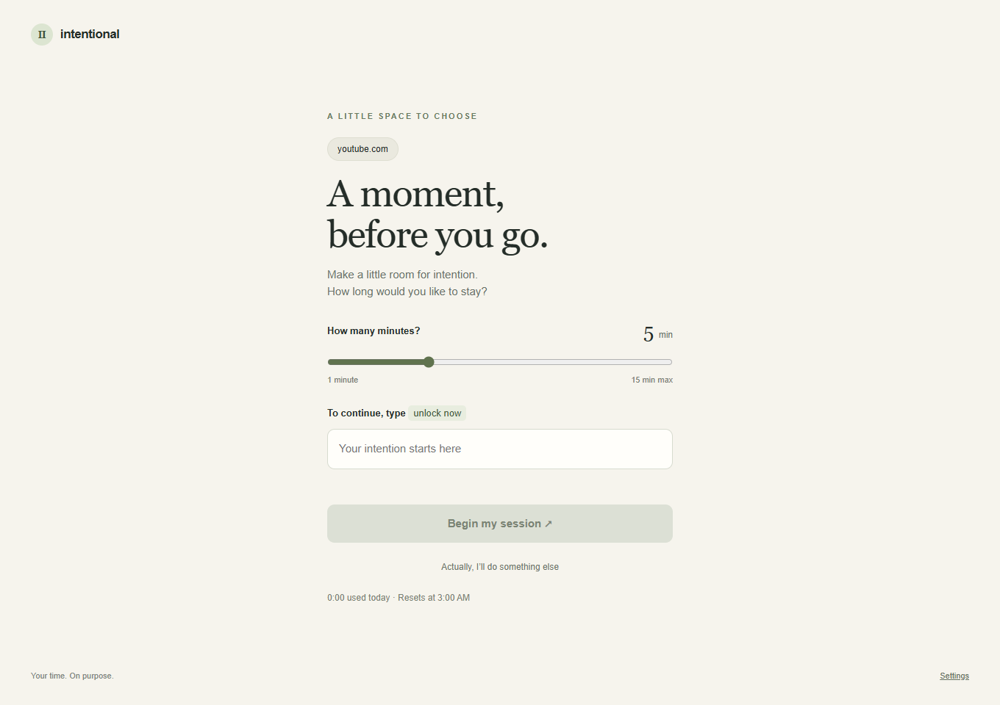
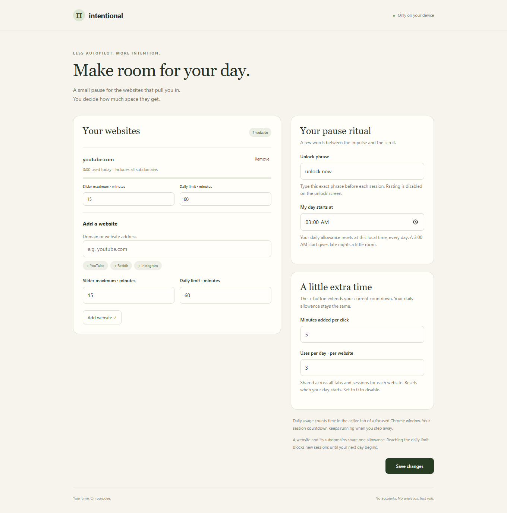

# Intentional

**A small pause between the impulse and the website.**

A local-only Chrome extension inspired by the idea behind one sec. Choose how long you want to browse, type your own unlock phrase, and stay within the daily allowance you set.



## What it does

- **A pause on selected websites.** Add a domain such as `youtube.com`; its subdomains are included.
- **Choose your session.** A minute slider asks how long you plan to stay. Each website has a configurable slider maximum.
- **Type to unlock.** Enter your exact preset phrase, such as `unlock now`. Pasting and dropping text are disabled.
- **See time remaining first.** A widget at 50% opacity in the top-right shows the session countdown in large text, with today's usage versus the daily allowance underneath. It includes an **End session** button.
- **Add a little time.** Click **+** to extend the current countdown. Configure minutes per click and a daily number of uses per website in settings (defaults: 5 minutes, 3 uses). Tabs and sessions share this quota. Extra time never increases the daily allowance, never changes recorded usage, and cannot run beyond the next reset. Set uses to 0 to disable.
- **Type without player shortcuts.** Keystrokes inside the pause screen are isolated from the website, so YouTube's spacebar shortcut cannot steal spaces from the unlock phrase.
- **Stop at your daily limit.** Once a website's allowance is used, the screen says it is blocked. There is no slider or unlock button until the next day starts.
- **Start your day when you want.** One shared reset time uses your computer's local timezone. The default is **3:00 AM**, including calendar-day handling across daylight-saving changes.

## Install in Chrome

No build is needed to run the extension.

1. Download **intentional-1.1.0.zip** from [Releases](https://github.com/HaiderHB/intentional-browsing/releases/latest) and extract it into a permanent folder.
2. Open `chrome://extensions` in Chrome.
3. Turn on **Developer mode** in the top-right.
4. Click **Load unpacked** and select the extracted folder containing `manifest.json`.
5. Pin **Intentional** from Chrome's extensions menu. Open its popup, select **Manage websites & settings**, add a website, and save.
6. Reload any website tabs that were already open when you installed it.

If you clone this repository instead, load the **`extension/`** subfolder. Chrome 120 or later is required. This is an unpacked extension, not a Chrome Web Store listing.

To update an existing unpacked installation, replace the extension files in the same folder, click the extension's **Reload** button at `chrome://extensions`, and reload already-open website tabs. Existing settings and current-day usage are preserved. Extra-time settings are added automatically.



## How time works

| Setting or counter | Behavior |
| --- | --- |
| Session slider | Grants that many elapsed minutes of access. The countdown continues when you switch tabs or leave Chrome. |
| Daily usage | Counts only while the website is in the active tab of a focused Chrome window. Background tabs and time away from Chrome do not count. Watching a video in the foreground counts even without mouse movement. |
| Multiple tabs | One session and one daily allowance per configured domain. Subdomains share both. Time is counted once. |
| Session expires | The pause screen returns, including on an already-open page. You can request another session if daily time remains. |
| + button | Adds the configured number of minutes to an open session, clipped to the remaining daily allowance and reset time. A successful click uses one daily extra-time use for that website, even if only part of the requested time fits. |
| Daily limit reached | All tabs for that website show the blocked screen. Typing the phrase cannot override the cap. |
| Less than a minute remains | The slider allows one last minute, but access is shortened to the remaining seconds. |
| Daily reset | Usage and extra-time uses reset and existing sessions end. You type your phrase again for the new day. |
| Browser restart | Daily usage and extra-time uses persist. Unlocked sessions end. |
| Save settings | Active sessions end so the new settings apply immediately. Usage is retained, including when you change the reset time or remove and re-add the same domain. |

Tracking is sampled roughly once a second. Long gaps caused by a sleeping computer or suspended page are discarded. There may be a small timing difference around tab switches. Session and reset alarms complement page heartbeats; Chrome can delay alarms while sleeping.

## Privacy and permissions

There are **no accounts, analytics, ads, remote fonts, external scripts, or extension network requests**. Settings and current-day per-domain totals are stored in `chrome.storage.local`; active sessions are stored in `chrome.storage.session`. The extension does not keep browsing history, page content, or full visited URLs. Uninstalling clears its stored data.

- **Website access on HTTP and HTTPS pages:** insert the pause screen and widget, identify the active configured domain, and apply newly saved websites without reinstalling. Only selected domains get a gate or ongoing usage tracking. Chrome will display its standard website-access permission notice.
- **Storage:** save settings, totals, and active sessions.
- **Alarms:** wake the service worker for session expiration and the daily reset.

## Scope

Intentional is a personal self-control tool. You retain control of its settings and can disable or uninstall it. The daily cap is enforced inside the extension's normal flow, not against deliberate changes in settings or developer tools.

The pause screen covers the page in a modal top layer and pauses top-level audio/video elements. It does **not** stop the website's network requests or every possible cross-origin embed. Background audio does not count toward foreground usage. Chrome's internal pages, the Chrome Web Store, and other protected browser pages do not allow this kind of content script. Full-domain HTTP(S) rules are supported; individual paths, schedules, Firefox, mobile Chrome, and cross-device sync are not included.

## Develop and test

Node.js 20 or newer. Runtime code is plain JavaScript with **zero shipped dependencies**.

```sh
npm ci
npm test
npm run check
npx playwright install chromium
npm run test:browser
npm run package
```

The browser suite loads the actual extension in an isolated Chromium profile. It covers settings, the gate, incorrect phrases, the slider cap, Escape handling, a narrow viewport, unlocking, the widget, reloads, shared subdomains, foreground accounting, multiple tabs, ending sessions, session expiry, the hard daily cap, and the daily reset. It also verifies keyboard isolation against simulated player handlers at both window/document capture and bubble phases, the widget's opacity and layout, configurable extra-time grants, shared quotas, and persistence across a real browser restart. Website fixtures avoid relying on a live service. A test-only clock shift speeds up expiry checks; no test hooks ship in the extension. Screenshots go to `test-results/`.

The unit suite covers domain matching and validation, overlaps, reset boundaries, daylight-saving days, concurrent unlocks, accounting, sleep gaps, partial-minute budgets, and persistence through serialization. `CHROMIUM_PATH` can select an existing compatible Chromium binary for local browser tests.

`npm run package` creates `dist/intentional-1.1.0.zip` containing just the ready-to-load extension. `node scripts/icons.mjs` regenerates the original pause icons.

An optional GitHub Actions workflow is included at [`docs/ci.example.yml`](docs/ci.example.yml). To enable it, add it as `.github/workflows/ci.yml` with an account or token allowed to manage workflows. It is a template, not an active repository check.

## Project layout

```text
extension/
  manifest.json     Chrome Manifest V3
  core.js           Time accounting, limits, validation, and day boundaries
  background.js     Serialized state updates and Chrome API integration
  content.js        Isolated pause screen and usage widget
  options.*         Website and ritual settings
  popup.*           Today's usage summary
  ui.css            Shared extension-page styles
  icons/            Original pause icons
tests/              Unit and real-extension browser tests
scripts/            Validation, icons, and ZIP packaging
```

## Similar open-source projects

Researched while defining this extension:

- [Focus by BlankSlateLabs](https://github.com/BlankSlateLabs/focus-chrome): scheduled website access, typed mindful pauses, and pause limits.
- [LiLimit](https://github.com/jonis100/LiLimit): per-visit or daily website time budgets, with a midnight reset described in its README.

Intentional is an original implementation combining a session slider, a custom exact phrase, a translucent usage widget, per-domain hard daily caps, and a configurable local day boundary. No source code or assets were copied from those projects. Not affiliated with one sec.

## License

[MIT](LICENSE)
